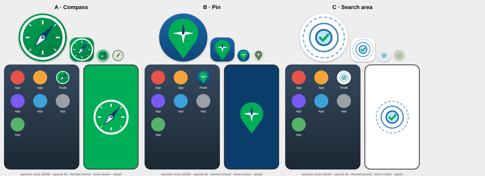

# App icon and splash

**Chosen: B · Pin** (2026-10-29). It is the app's launcher icon (adaptive, with a themed
monochrome layer) and its splash screen on navy `#0B3D6B`. The other concepts are kept for reference.

# Concepts

Three concepts in Girl Scout green (`#00AE58`, deep `#00703C`) with blues (`#1F6FB2`, navy
`#0B3D6B`, sky `#BFE3F7`). Only the colours are borrowed: there is no Girl Scouts trefoil or
other mark.



Each concept is shown as a launcher icon (circle at 192 and 48 px, squircle at 96 px), as a
themed monochrome icon (Android 13+), on a home screen, and on the Android 12+ splash screen.

| Concept | Idea | Splash background |
| --- | --- | --- |
| **A · Compass** | White compass ring with a navy needle on green: says "find your way". Clearest at small sizes. It is close to other compass icons (e.g. Safari), so it's the least distinctive. | Green |
| **B · Pin** | Green map pin with a white compass star on a blue gradient: "a place" plus "direction". Distinctive and reads well at 48 px. | Navy |
| **C · Search area** | Blue search rings around a green check, on white: the compass's search-area view plus "found it". Lightest look; the outer dashed ring gets faint at 48 px. | White |

## Files

`generate_concepts.py` writes, for each concept, the adaptive-icon layers (`*-background.svg`,
`*-foreground.svg`, with the foreground kept inside the 66% safe zone), the combined
`*-icon.svg`, and `*-monochrome.svg`. `preview.js` renders `preview.png`.

```bash
python3 docs/branding/generate_concepts.py
node docs/branding/preview.js docs/branding docs/branding/preview.png
```

## Updating the app's icon

1. Change `generate_concepts.py`, then regenerate the SVGs (above).
2. Export the chosen concept to the app's 1024×1024 PNGs (`icon.png`, the three
   `android-icon-*.png` layers and `splash-icon.png`):
   `node docs/branding/export_png.js docs/branding b-pin source/assets`
3. `app.json` sets `android.adaptiveIcon.backgroundColor` and the `expo-splash-screen` plugin
   (image, background colour, dark-mode colour); `__tests__/config/appConfig.test.ts` checks them.
4. Check the launcher icon and splash on a device (launchers cache icons; reinstall if needed).
