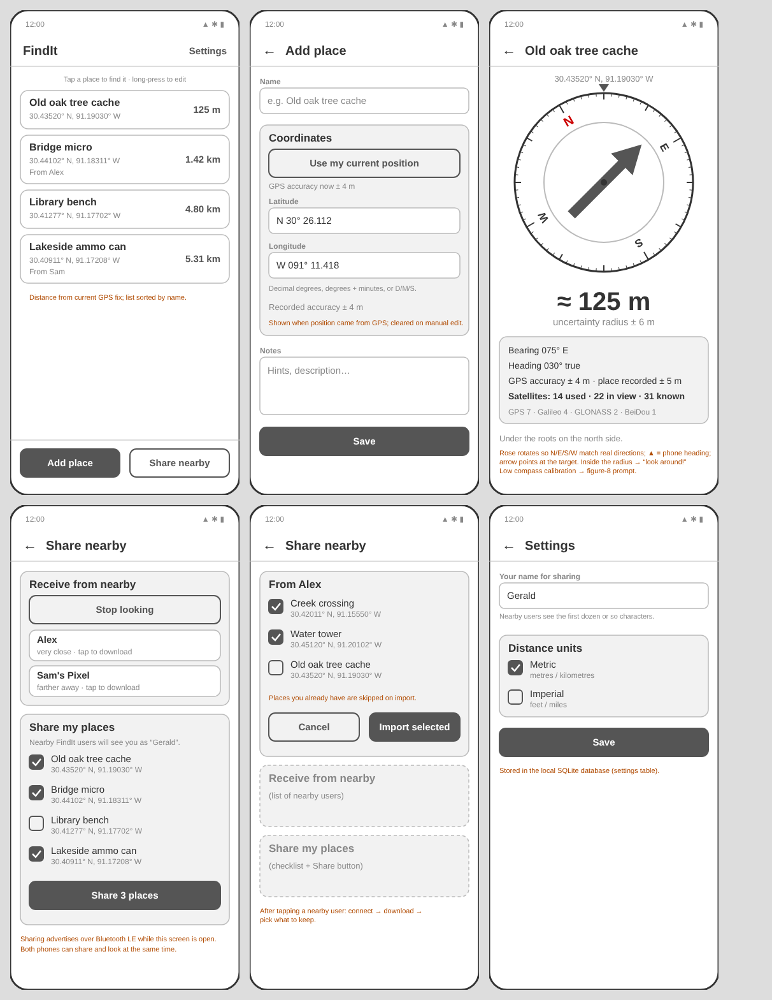
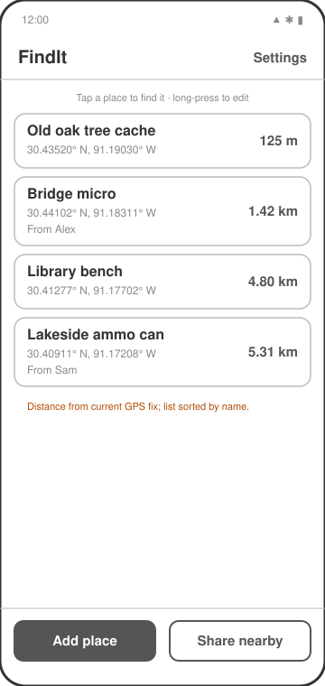
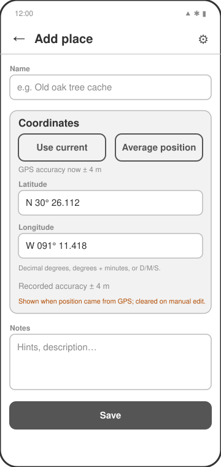
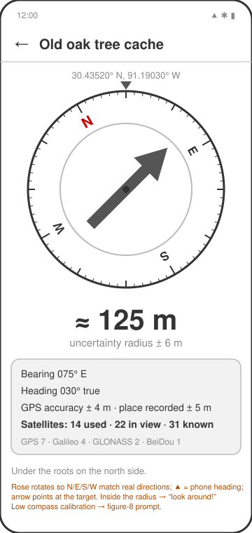
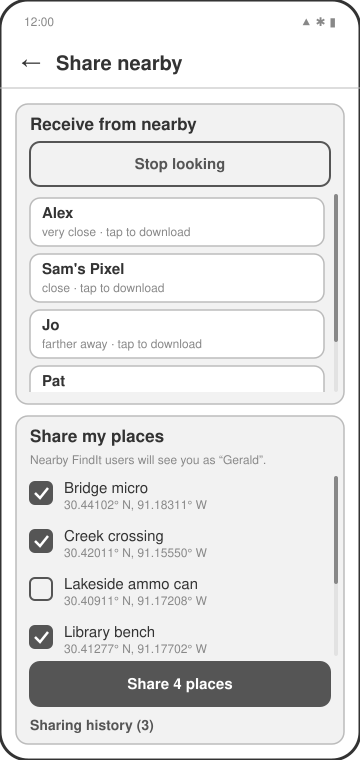
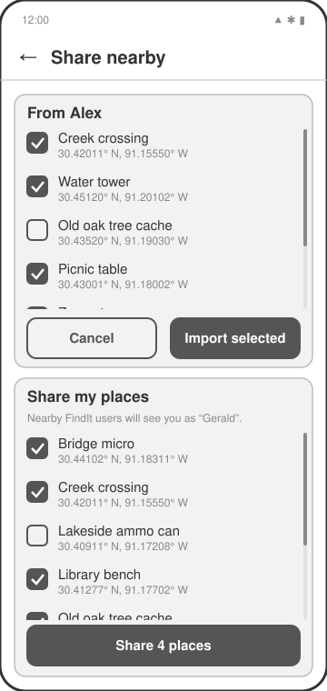
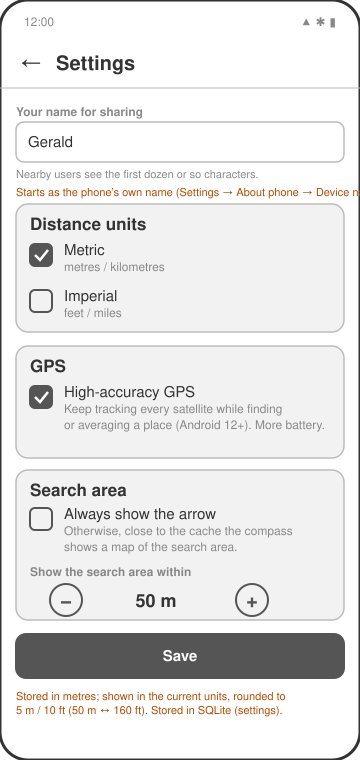

# Wireframes

Low-fidelity wireframes of every screen. They are generated by
[`wireframes/generate_wireframes.py`](wireframes/generate_wireframes.py); edit that script
and re-run it (`python3 docs/wireframes/generate_wireframes.py`) rather than editing the SVGs.
Orange text is annotation, not UI.

## 1. Places (home)

The list of known places, sorted by name, with the distance from your current GPS fix.
Tap a place to open the compass; long-press it to edit or delete. Places received from
someone else show who they came from.

## 2. Add / edit place

Name, coordinates and notes. **Use my current position** fills in the coordinates and
records the GPS accuracy at that moment (used later in the uncertainty radius). Coordinates
can also be typed as decimal degrees (`30.4352`), degrees and decimal minutes
(`N 30° 26.112`, the usual geocaching format) or degrees/minutes/seconds.

## 3. Compass ("Find it")

- **Outer ring (compass rose)** rotates against the phone's heading so N/E/S/W always
  point at the real directions (true north when available).
- **Arrow** points at the chosen place.
- The fixed **▲** at the top marks where the phone is pointing.
- Below the compass: approximate distance and the **uncertainty radius**, the
  combined 1-sigma error of your GPS fix and the accuracy recorded with the place
  (√(gps² + place²)). When you are inside that radius the app tells you to look around.
- Details: bearing, heading, GPS accuracy, and **satellites used / in view / known**, with
  the used satellites broken down by constellation.

## 4. Share nearby

Two independent halves. **Receive from nearby** scans for phones that are sharing and lists
them by name and rough signal strength. **Share my places** lets you tick which places to
offer and starts Bluetooth advertising while the screen is open.

## 5. Share nearby: import

After tapping a nearby user, their places download and you choose which to keep.
Places you already have (same name, same coordinates) are skipped.

## 6. Settings

Your display name (what others see when you share) and distance units.

