# Wireframes

Low-fidelity wireframes of every screen. They are generated by
[`wireframes/generate_wireframes.py`](wireframes/generate_wireframes.py); edit that script
and re-run it (`python3 docs/wireframes/generate_wireframes.py`) rather than editing the SVGs.
Orange text is annotation, not UI.

## 1. Places (home)

The list of known places, sorted by name, with the distance from your current GPS fix.
Tap a place to open the compass; long-press it to edit or delete. Places received from
someone else show who they came from. The list scrolls when there are more places than fit;
the **Add place** / **Share nearby** buttons stay fixed at the bottom. Found places show a
✓ line ("Found 2026-10-29", "Found 3 times, last …", or "Found by Sam …" for someone else's
find). **Hide found places** hides the ones *you've* found and says how many are hidden; the
choice is remembered. Neither appears when Settings → Found places is **Off**. **Map** (header) opens the map;
**Files** opens Import / Export; **?** opens help. Long-press also offers **Show on map**.

## 2. Add / edit place

Name, coordinates and notes. **Use current** fills in the coordinates from the latest fix and
records its GPS accuracy (used later in the uncertainty radius). **Average position** collects
fixes while you stand still (next screen) for more accurate coordinates. Coordinates
can also be typed as decimal degrees (`30.4352`), degrees and decimal minutes
(`N 30° 26.112`, the usual geocaching format) or degrees/minutes/seconds.

## 2b. Add / edit place: averaging

While averaging, the panel shows how many fixes have been collected and for how long, the
estimated accuracy of the average (it shrinks as fixes accumulate), how much the fixes wander,
and the satellites in use. **Use average** fills in the coordinates and the recorded accuracy.
Fixes worse than 30 m are ignored.

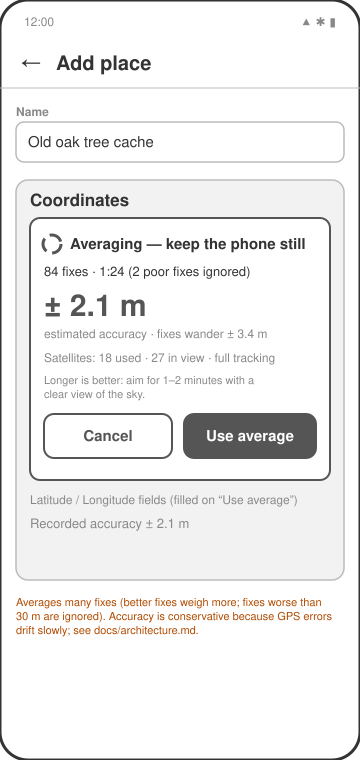

## 3. Compass ("Find it")

- **Outer ring (compass rose)** rotates against the phone's heading so N/E/S/W always
  point at the real directions (true north when available).
- **Arrow** points at the chosen place.
- The fixed **▲** at the top marks where the phone is pointing.
- Below the compass: approximate distance and the **uncertainty radius**, the
  combined 1-sigma error of your GPS fix and the accuracy recorded with the place
  (√(gps² + place²)). When you are inside that radius the app tells you to look around.
- Details: bearing, heading, GPS accuracy, and **satellites used / in view / known**, with
  the used satellites broken down by constellation, plus whether full GNSS tracking is on.
- Heading and position are smoothed over a few seconds, so the rose and the distance don't jitter.

## 3e. Compass: mark found

**Mark found** asks for an optional comment, then records the find with today's date; the
compass shows "✓ Found <date>" and the comment. With **Once per place**, marking again shows
"Update find" and replaces the date and comment; with **Keep a log**, every find is kept.
Exporting or sharing places that have been found asks **Include found information?**

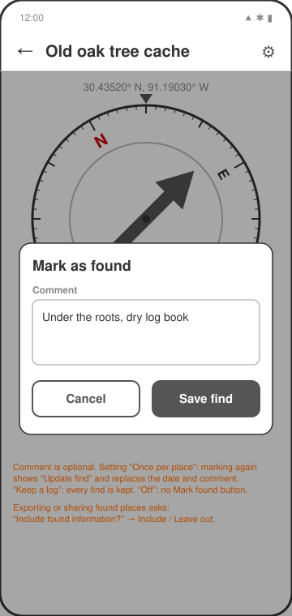

## 3b. Compass: averaging my position

**Average my position** is for when you're standing still near the cache. Your fixes are
averaged, and the distance, arrow and uncertainty radius use the average, so they stop jumping
and the radius shrinks over a minute or two. **Stop averaging** returns to live readings.
Walking away stops it by itself: a fix more than 3× its accuracy (at least 10 m) from the
average shows "Stopped averaging because you moved." Nothing is saved.

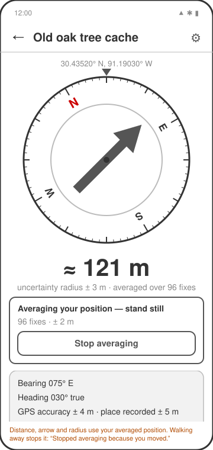

## 3c. Compass: search area

Within the distance set in **Settings → Search area** (default 50 m), the inner circle of the
compass becomes a small heading-up map (north-up if there's no compass reading):
- **you:** a blue dot at the centre, with a faint halo for your own GPS uncertainty;
- **the cache:** ⊕ in the direction of the arrow, at scaled distance;
- **the search area:** a shaded circle around the cache, as big as the uncertainty radius;
- **scale:** a dashed half-way ring and labels (e.g. "10 m", "20 m"; feet in imperial). The
  map picks the smallest round scale that holds the cache and its circle, so it zooms in as
  you get closer.

Further away, the compass shows the arrow as before.

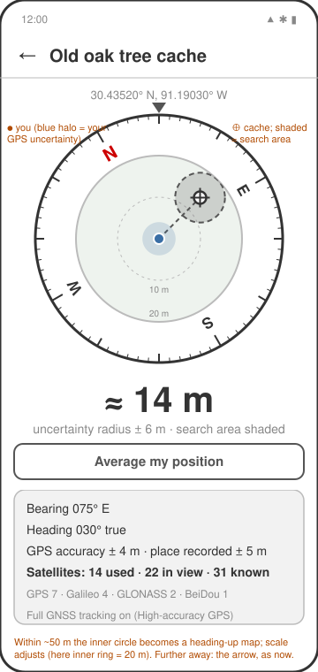

## 3d. Compass: inside the search area

When you're inside the shaded circle, a banner says you're in the search area. With
**Average my position** running, your halo and the circle shrink as fixes accumulate.

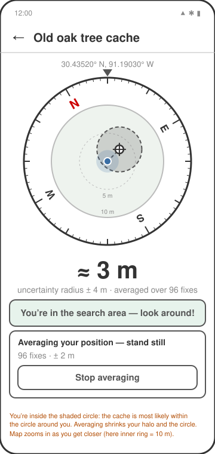

## 3f. Compass: map behind the search area

Optional (Settings → **Behind the search area**: Plain, Map or Satellite). Inside the search
area a round street map or satellite image sits under the rings, heading-up and at the same
scale, so the search circle lands on real paths and trees. Satellite is US only; elsewhere the
street map is used. Map credits show under the compass. Saved offline maps are used with no
connection.

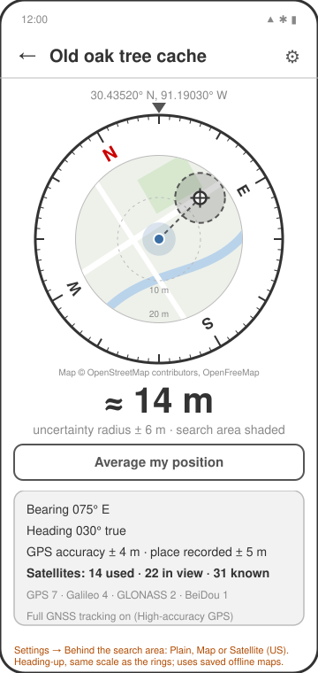

## 4. Share nearby

Two independent halves. **Receive from nearby** scans for phones that are sharing and lists
them by name and rough signal strength. **Share my places** lets you tick which places to
offer and starts Bluetooth advertising while the screen is open. The two sections split the
screen; the nearby-users list and the places checklist each scroll inside their own section,
so the **Look for…** and **Share N places** buttons are always visible. Both phones can share
and look at the same time. **Sharing history (N)** under the share button opens the history.

## 5. Share nearby: import

After tapping a nearby user, their places download and the import panel replaces the
"Receive from nearby" section until you import or cancel. The received list scrolls, with
**Cancel** / **Import selected** fixed below it. Places you already have (same name, same
coordinates) are skipped.

## 8. Sharing history

Who downloaded my places and when, newest first, with how many places they took. A row is
added when the other phone disconnects after downloading; older FindCache versions don't send a
name and appear as "FindCache user". Entries past the retention set in Settings are removed when
this screen or the Share screen opens. **Clear history** asks first.

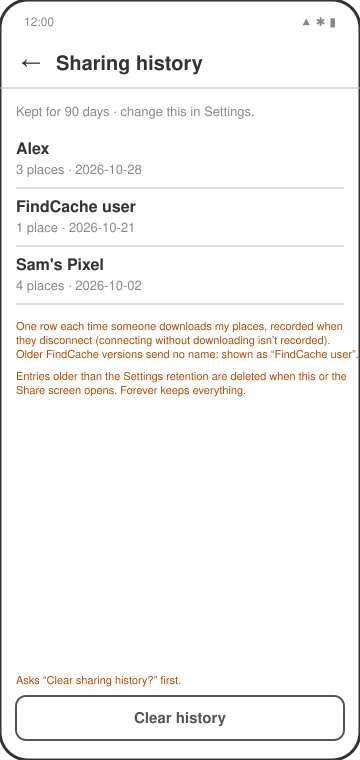

## 9. Map

Every place on a free street map (OpenFreeMap, built from OpenStreetMap data) or, with
**Satellite**, USGS imagery (public domain, United States only; outside it a note says so).
The blue dot is you. The map opens framed to fit all places, centred on one place when opened
from **Show on map**, or following you when there are no places. Tap a place for a card with
its distance and **Find it** (opens the compass). The layer choice is remembered. Map data
credits are behind the ⓘ button.

**⤓ Download** saves the area on screen, for the current layer, for use with no connection;
progress shows under the buttons. **Offline maps** (header) lists the saved areas.

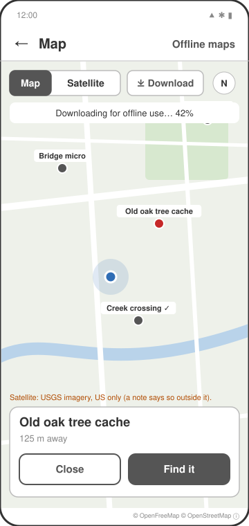

## 10. Offline maps

Saved areas, newest first, with layer, size and state (downloading N% or ready), and the total
size. **Delete** asks first. Downloads cover zooms 10–14 for Map and 10–16 for Satellite
(US only); an area needing more than about 6,000 tiles is refused with a hint to zoom in.

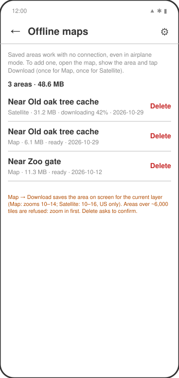

## 11. Help

Every screen has **?** at the top right. It opens a small menu: **Help for this screen**
(that screen's topic), **How to use FindCache** (getting started, then every screen's topic), and
**About FindCache**. The help text is in `source/src/help/content.ts`.

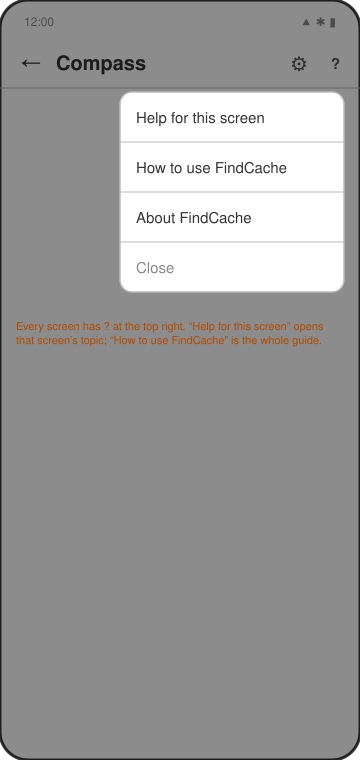

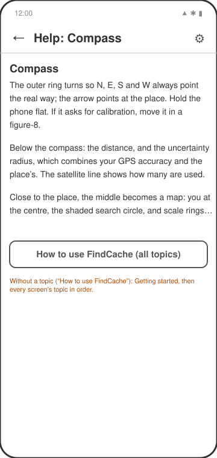

## 12. About and licences

The app icon, name and version (the release's date version), a short description, and three
buttons: **FindCache licence** (BSD 2-Clause), **Open-source licences** (every JavaScript package in
the app and the main native libraries; tap one for its licence text) and **Map data**
(OpenStreetMap, OpenFreeMap / OpenMapTiles, USGS, with links).

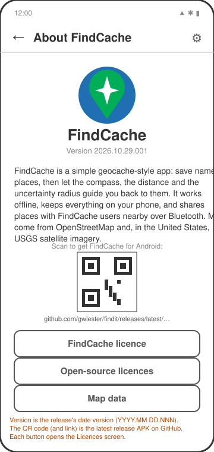

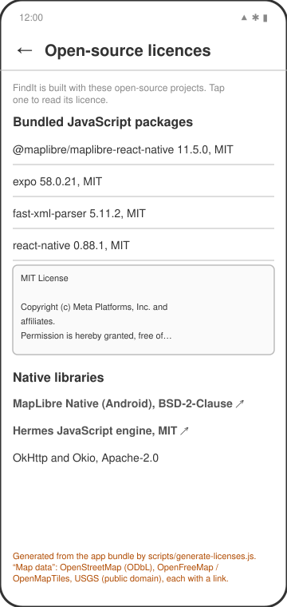

## 7. Import / Export

**Import**: choose a file with the system file picker. The format is detected automatically
(see below). **Export**: tick the places to export. **Export N places…** asks for the format
each time, GPX or GeoJSON, then opens the Android share sheet (save to Files or Drive, email,
or send to another app).

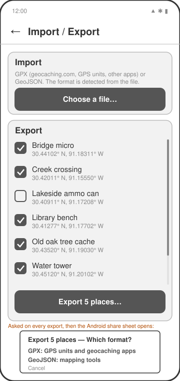

## 7b. Import / Export: importing a file

After choosing a file, its places are listed to pick from. The format is chosen from the file
extension (`.gpx`, `.geojson`, `.json`), then its MIME type, then its content. For
geocaching.com files, the cache name and code become the place name and the hint goes into the
notes. Places you already have (same name and position) are skipped.

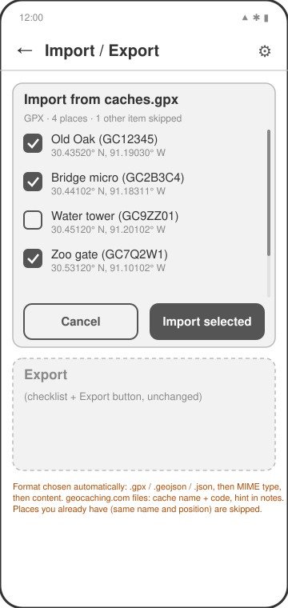

## 6. Settings

Your display name (what others see when you share), distance units, and **High-accuracy GPS**
(full GNSS tracking on the compass and averaging screens; on by default), and **Search
area**: the distance at which the compass switches from the arrow to the search-area map
(stored in metres, shown in your units rounded to 5 m / 10 ft, converted when you change
units), or **Always show the arrow**; and what's **behind the search area**: Plain (default),
Map, or Satellite (US only).

Further down: **Found places**: Off, Once per place (default), or Keep a log. Switching from a
log to "once" keeps all entries; the latest one is shown. **Sharing history**: how long to
remember who downloaded my places: 7 days, 30 days, 90 days (default), 1 year, or Forever.

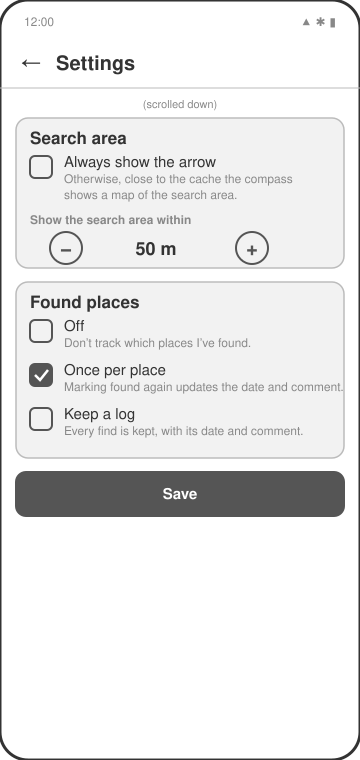

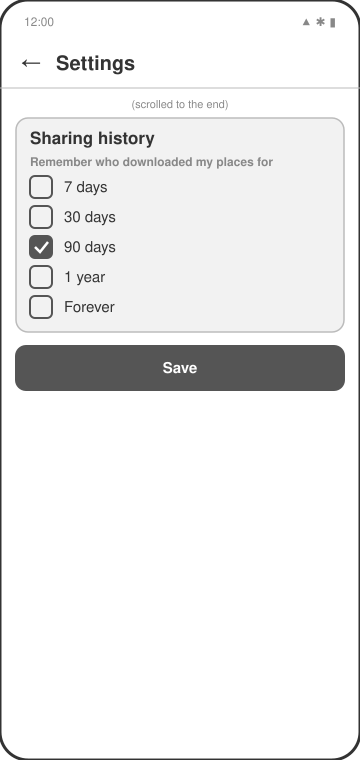
